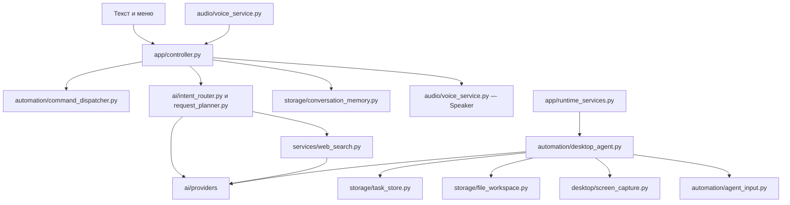

# Архитектура Capri

`main.py` — единственная точка входа для исходников и EXE. Он передаёт управление `capri/app/bootstrap.py`. Альтернативный запуск того же приложения: `python -m capri`.

```text
capricorn-main/
├── main.py                         # короткая точка входа
├── run.bat / setup*.bat / update.bat
├── capri/
│   ├── app/                        # запуск и координация приложения
│   │   ├── bootstrap.py            # Windows / portable / диагностика / голосовой worker
│   │   ├── windows_application.py  # QApplication, окна, трей, старт и выход
│   │   ├── portable_application.py # ограниченный режим macOS/Linux
│   │   ├── controller.py           # имя/стоп, очередь, маршрутизация и ответы
│   │   ├── runtime_services.py     # соединение заданий, экрана, файлов и рабочего стола
│   │   └── diagnostics.py          # проверка собранного приложения
│   ├── config/
│   │   ├── defaults.py             # DEFAULTS: стандартные значения
│   │   └── settings.py             # чтение/сохранение config.json, профиль пользователя
│   ├── core/
│   │   ├── paths.py                # пути исходников/EXE/ресурсов, личные имена файлов
│   │   └── cancellation.py         # отмена запросов, очереди и соединений
│   ├── ai/
│   │   ├── intent_router.py        # классификация команды
│   │   ├── request_planner.py      # локальный ответ или поиск, отбор источников
│   │   ├── model_selection.py      # выбор локальной модели по режиму работы
│   │   ├── providers/              # OpenAI, Gemini, Claude/NVIDIA/DeepSeek, Ollama, GGUF
│   │   └── persona/                # промпты, настроение и редактируемая личность
│   ├── audio/
│   │   ├── voice_service.py        # Listener, Speaker, звук и кэш фраз
│   │   ├── speech_recognition.py   # Parakeet / Windows Speech
│   │   └── kokoro_backend.py       # изолированный процесс локальной озвучки
│   ├── automation/
│   │   ├── command_dispatcher.py   # обычные команды и проверка решений модели
│   │   ├── desktop_agent.py        # шаги автономного задания
│   │   ├── agent_input.py          # указатель агента, клики и клавиатура
│   │   ├── window_input.py         # ввод и цепочки действий в окнах
│   │   └── application_search.py   # поиск установленных программ
│   ├── desktop/
│   │   ├── avatar.py              # отрисовка персонажа и диалоговой панели
│   │   ├── window_companion.py    # опоры, курсор, прогулки и горячие клавиши
│   │   ├── screen_capture.py      # снимки в памяти и фильтр изменений
│   │   └── music_reactions.py     # танец от выходного звука
│   ├── storage/
│   │   ├── conversation_memory.py # memory.json и me.md
│   │   ├── file_workspace.py      # выбранные файлы, правки и резервные копии
│   │   └── task_store.py          # SQLite: задания, расписание, прогресс, журнал
│   ├── services/                  # веб-поиск и погода
│   ├── platform/
│   │   ├── startup.py             # автозапуск
│   │   └── windows/               # медиасессии, гамма экрана, обход сетевых сбоев
│   ├── ui/
│   │   ├── mainframe.py           # панель MAINFRAME
│   │   ├── tray_menu.py           # меню в трее
│   │   ├── theme.py               # общая тема и базовые диалоги
│   │   ├── startup_animation.py   # таймер, появление аватара и извлечение
│   │   ├── startup_scene.py       # камера и полёт в красную линзу глаза
│   │   ├── shutdown_scene.py      # извлечение чипа и падение персонажа
│   │   ├── neural_head.py         # общая киберголова и красная линза
│   │   ├── chip_art.py            # общая флешка для трея и заставок
│   │   └── dialogs/               # AI, звук, профиль, сайты и приложения
│   └── updates/                   # обновление исходников и автономного EXE
├── tools/                         # установка, подготовка ресурсов и сборка
├── tests/                         # проверки без платных API и управления чужими окнами
├── docs/                          # документация
├── assets/ / media/ / bundled/     # ресурсы и встроенный архив Vosk
├── models/                        # скачанные локальные модели
└── dist/ / build/ / reports/       # результаты сборки, кэш и диагностика
```

## Обработка запросов



Имя обрабатывается по промежуточному распознаванию: подтверждение «Слушаю…» не ждёт завершения фразы. «Стоп» и отмена соединений проходят через `core/cancellation.py`. Обычные команды выполняются до обращения к модели. API-режим не создаёт и не прогревает Ollama.

## Правила зависимостей

1. `main.py` и `capri/__main__.py` только запускают bootstrap. Пакет `capri` не открывает окна при импорте.
2. `app` соединяет подсистемы. Создание Qt-приложения и трея находится в `windows_application.py`, обработка запросов — в `controller.py`.
3. `core` и `storage` не импортируют интерфейс, провайдеры AI или контроллер приложения. Хранилища получают пути явно.
4. `ui` показывает состояние и вызывает переданные контроллеры/сервисы. Сохранение настроек вынесено в `config/settings.py`; для него не нужно импортировать Windows-приложение.
5. Все импорты собственного кода — через `capri.…`. В корне нет дубликатов прежних модулей или подмен через `sys.modules`.
6. Расположение ресурсов определяется в `core/paths.py`, а не относительно текущего рабочего каталога или папки конкретного модуля.
7. Отдельные процессы запускаются по имени пакета: `python -m capri.audio.kokoro_backend` и `python -m capri.updates.source_updater`. Они не зависят от расположения своего `.py`-файла.
8. В `__init__.py` нет загрузки моделей, импорта Win32 или запуска фоновой работы.

## Пользовательские данные

При реорганизации меняются только исходники. `config.json`, `memory.json`, `me.md`, `personality.md`, `personality.backup.md` и `jobs.sqlite` остаются возле точки запуска, с прежними именами и форматом. У EXE это папка приложения. Модели остаются в `models/`.

Список личных имён файлов задан в `core/paths.py` как `PRIVATE_FILENAMES`. Его используют упаковщик исходников и обновление приложения. Личные файлы не входят в релиз и не перезаписываются обновлением.

## Команды разработчика

```powershell
python -m pip install -r requirements-dev.txt
python main.py
python -m capri
python -m unittest discover -s tests -q
python -m tools.package_source_release reports/Capri-Source.zip
python -m tools.build_desktop
```

Установщик Inno Setup: `tools/capri_installer.iss`. Скрипты `setup.bat`, `setup_ai.bat`, `setup_voice.bat`, `update.bat` используют новые пути. Для проверки без микрофона и моделей:

```powershell
$env:QT_QPA_PLATFORM = 'offscreen'
python main.py --smoke-test reports/smoke
```

История переименований: [таблица файлов](renamed_files.md). Устройство функций и расширение приложения: [разработка](development.md). Пользовательские возможности: [руководство](user_guide.md).
